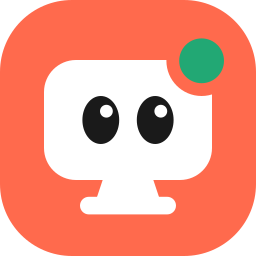
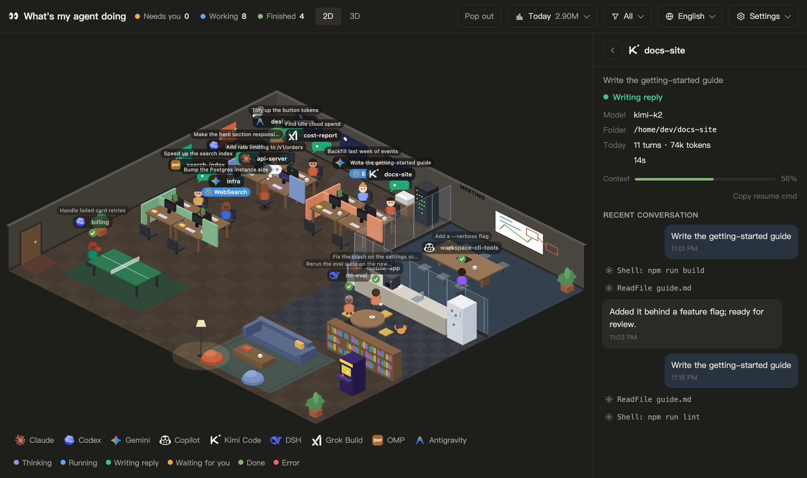
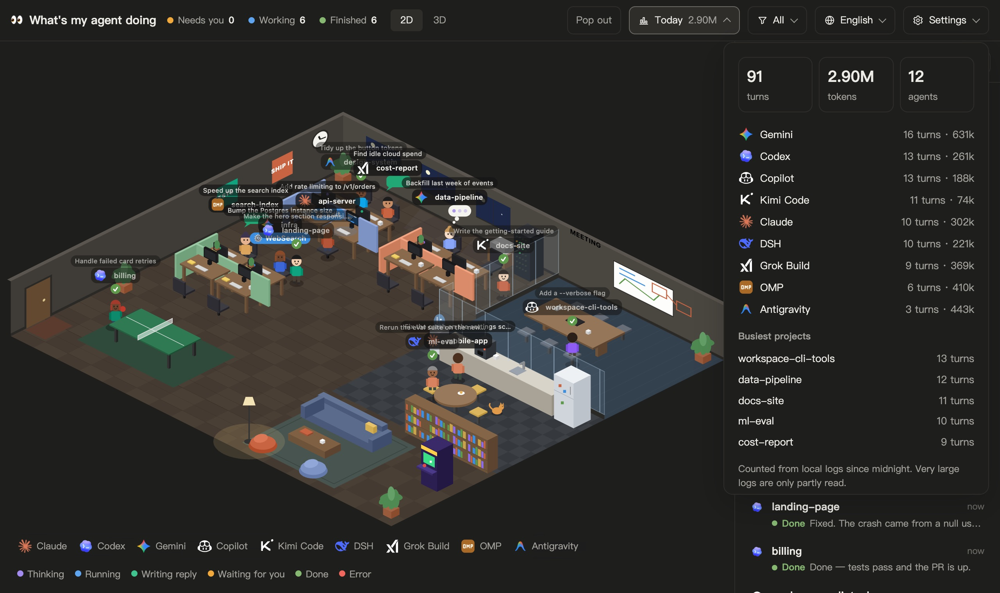
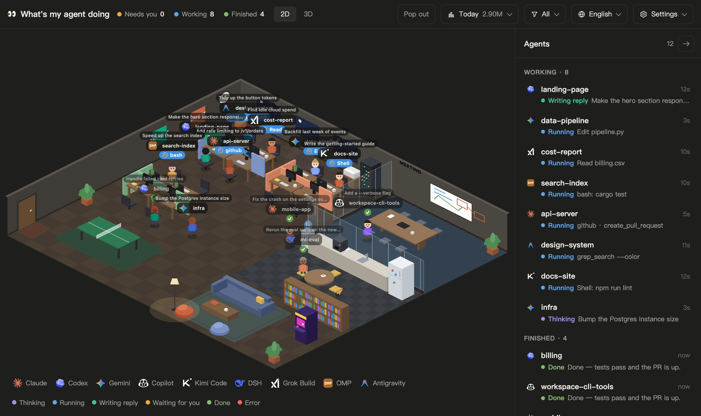

# whatsmyagentdoing

**Type `/myoffice` and see what every coding agent on your machine is doing — live, in a little office.**

Who is thinking, who is running a tool, who is waiting for you, who just finished. Works with Claude Code, Codex, Gemini CLI, Antigravity CLI, Copilot CLI, OMP, Pi, Kimi Code, DeepSeek Harness, Grok Build, OpenCode and Hermes. Nothing leaves your machine.

**Website:** https://charonyuu.github.io/whatsmyagentdoing/

https://github.com/user-attachments/assets/d29fac22-a4d8-4cca-8252-6fd34c7ce713

| Click an agent to see what it's doing | Today's turns and tokens |
|---|---|
|  |  |

<sub>Recorded with `--demo` (a made-up team), so no real sessions are shown.</sub>

## Install

**Easiest: ask your agent.** Paste this into Claude Code or Codex:

> Install the myoffice skill from https://github.com/Charonyuu/whatsmyagentdoing: clone it with `git clone --depth 1` into `~/.claude/skills/myoffice` (for Codex: `~/.codex/skills/myoffice`), check that `node --version` is 18 or newer, then tell me to start a new session and type /myoffice.

Or do it yourself:

```bash
# Claude Code
git clone --depth 1 https://github.com/Charonyuu/whatsmyagentdoing ~/.claude/skills/myoffice

# Codex
git clone --depth 1 https://github.com/Charonyuu/whatsmyagentdoing ~/.codex/skills/myoffice
```

Then type **`/myoffice`** (or just ask *"what are my agents doing?"*). The office opens in your browser.

Needs Node.js 18+ (22.13+ to include OpenCode and Hermes). Nothing to `npm install` — the repo runs as cloned. Prefer no skill? `node bin/cli.js` from a clone works too.

## What you get

**The office.** Agents that are working sit at their desks: a thought bubble while thinking, code scrolling on the monitor while a tool runs, standing up and waving when they need you. Recently finished ones go off duty and wander — coffee in the pantry, the couch, ping-pong, a nap at an empty desk. Hover anyone to see what they're on; click to open them in the side panel.

**Live status for every session:**

| Status | Meaning |
|---|---|
| Thinking | reasoning, or reading a tool result |
| Running | a tool call is in flight — shows which (`Bash: npm test`, `Edit app.ts`, `github · create_pr`) |
| Writing reply | started its answer, turn not finished yet |
| Waiting for you | asked you a question or needs approval |
| Done | turn finished, with the last reply |
| Interrupted / Error / Idle | |

**The side panel** groups sessions into **Needs you → Working → Finished**. Click one to see its model, folder, today's usage, how full its context window is, a copy button for the resume command, and its recent conversation (your messages, its replies and the tools it ran). Session titles also float above the agents in the office; turn them off in **Settings → Session titles**.

**Alerts.** When an agent needs you, the page can send a browser notification and play a short chime (**Settings → Sound**). A tool that runs for more than 10 minutes, or thinking that goes silent for 8, is flagged as *No progress*, so a hung command doesn't cost you an hour.

**Today.** Turns and tokens since local midnight, by agent and by project.

**2D or 3D.** **2D** is a hand-drawn canvas with no dependencies. **3D** adds real-time lighting and shadows using [Kenney](https://kenney.nl)'s CC0 models; drag to rotate, scroll to zoom. The 3D bundle only loads when you pick it.

**Scenes (3D).** Besides the office there are seven downloadable scenes: Christmas Cabin, Neon Arcade, Haunted Hollow, Pirate Cove, Café, Space Station and Castle (about 100–290 KB each). Pick one from **Settings**, run `--scene pirate`, or ask your agent. Packs are data only and are checked against a pinned SHA-256 before they're installed.



**Pop out.** In browsers with [Document Picture-in-Picture](https://developer.chrome.com/docs/web-platform/document-picture-in-picture), the office or a compact list floats in an always-on-top window that stays in sync with the main tab. Elsewhere, **Pop out** starts a local, view-only video of the office you can float with the browser's own video PiP; no screen sharing, nothing uploaded.

**Ten languages.** English, 繁體中文, 简体中文, 日本語, 한국어, Español, Français, Deutsch, Português and Русский. It follows the language you write your prompts in, falling back to your browser's; pick one from the toolbar to override.

## Supported agents

| Agent | Read from | Resume |
|---|---|---|
| Claude Code (CLI, desktop, IDE) | `~/.claude/projects/` | `claude --resume` |
| Codex (CLI, desktop, IDE) | `~/.codex/sessions/` | `codex resume` |
| Gemini CLI | `~/.gemini/tmp/` | `gemini --resume` |
| Antigravity CLI | `~/.gemini/antigravity-cli/` | `agy --conversation` |
| Copilot CLI | `~/.copilot/session-state/` | `copilot --resume` |
| OMP (oh-my-pi) | `~/.omp/agent/sessions/` — [details](docs/omp.md) | from its log |
| Pi | `~/.pi/agent/sessions/` | `pi --session` |
| Kimi Code | `~/.kimi-code/sessions/` | `kimi --session` |
| DeepSeek Harness (DSH) | `~/.dsh/sessions/` | `dsh tui --resume` |
| Grok Build | `~/.grok/sessions/` | `grok --resume` |
| OpenCode | `~/.local/share/opencode/opencode.db` | `opencode --session` |
| Hermes | `~/.hermes/state.db` (Windows: `%LOCALAPPDATA%\hermes`) | `hermes --resume` |

All of them are read-only. Paths, environment overrides and per-agent details: [How each agent is read](docs/agents.md). Sessions seen by a local Magpie gateway can be added too: [Magpie](docs/magpie.md). The Google Antigravity desktop app keeps its conversations in an undocumented binary store and isn't supported yet; its `agy` CLI is.

## Options

```
-p, --port <n>    Port (default 4545; next free one if taken)
--hours <n>       Sessions active in the last n hours (default 24)
--omp-dir <path>  OMP sessions root, or a directory passed to omp --session-dir
--no-open         Don't open the browser
--private         Hide prompts, replies and titles — status only (screen-share safe)
--json            Print one snapshot as JSON and exit
--demo            Show a made-up team instead of your sessions (screenshots, trying it out)
--stop            Stop a running dashboard (or say /myoffice stop)
--update          git pull the latest version and restart (or say /myoffice update)
--scenes          List 3D scenes, installed and downloadable
--scene <id>      Download a scene if needed and open the office in it
--install-hook    Optional: add a Claude Code hook so permission prompts show "Waiting for you"
--uninstall-hook  Remove that hook again
```

Running it again while it's up just reopens the tab.

**Updates:** it keeps itself up to date. The page checks this repo's `package.json` about every half hour; when a newer version is out it runs `git pull --ff-only` in the install folder and restarts the dashboard. If that pull fails (say you changed files in the clone), an **Update** button stays on the page instead. `--update` or `/myoffice update` does the same from the command line. Set `WMAD_NO_UPDATE_CHECK=1` to turn checking and updating off.

## Privacy

Nothing leaves your machine. The server binds to `127.0.0.1` only and rejects requests that aren't addressed to localhost. It tails the agents' own log files read-only and pushes statuses to the page over Server-Sent Events. No runtime dependencies — read `src/` in five minutes. With `--private`, prompts, replies and titles never reach the page.

## Limits

- Logs are written per finished block, not per token, so "Writing reply" means a reply block has landed — not a live keystroke stream.
- Claude Code doesn't log permission prompts, so a tool waiting on your approval shows as "Running" until you answer. `node bin/cli.js --install-hook` adds an optional hook that fixes this ([details](docs/agents.md#agent-specific-limits)).
- The log formats aren't public APIs. If an update changes them, statuses may degrade — please open an issue.

## Contributing

PRs are welcome — several agents and languages here came from the community. See [Development checks](docs/development.md) for the test commands.

## License

MIT. 3D models in `assets/kenney/` are by [Kenney](https://kenney.nl), released under CC0 (see the license files there).
